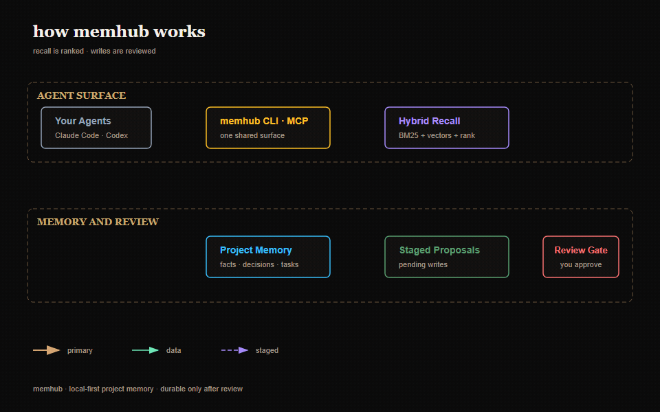
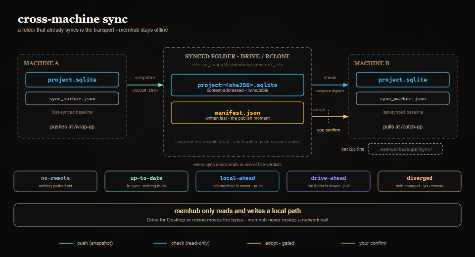
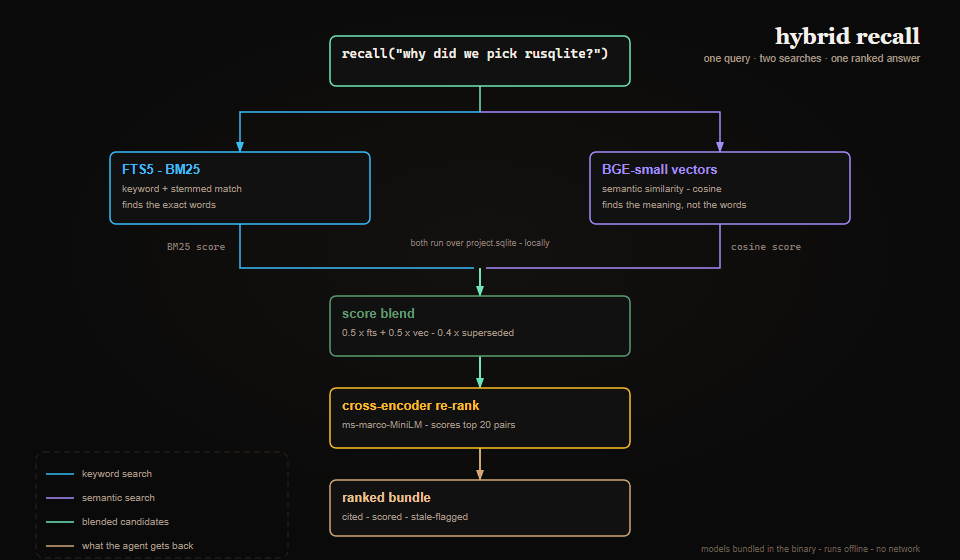

# memhub

*Your AI agents forget things. memhub doesn't.*

<p align="center">
  
  
  
  <br/>
  
  
  
  <br/>
  
</p>

---

Every new session, your AI agent starts from zero. You re-explain the build command, the naming conventions, and why you chose Postgres over SQLite six months ago. memhub gives the agent a persistent, searchable memory of your project, so it looks those things up instead of asking you again.

memhub is one offline binary and one SQLite file next to your code. Claude Code, Codex, and OpenCode all share it. It holds decisions (with the *why* behind them), facts, tasks, your own reference docs, and an index of where things live in your codebase. When the agent needs context, it pulls a small ranked bundle of just the relevant rows, not your whole README. Prompts stay short and your token bill stays down. There is no cloud, no account, and no daemon, and everything, including semantic search, runs locally.

**[Jump to Quickstart →](#quickstart)** · **[See how it works →](#how-it-works)**

<details>
<summary><b>Plain-word definitions</b> of the technical terms used below</summary>

- **MCP** (Model Context Protocol): a standard way for an agent to call a local tool, such as memhub, as a structured function.
- **Skills**: the short instruction files, such as `/wrap-up` and `/recall`, that memhub installs for each agent.
- **FTS5**: SQLite's built-in full-text search. It finds rows by the words they contain.
- **BM25**: the formula FTS5 uses to rank rows by how well their words match a query.
- **BGE-small**: the small embedding model bundled in the binary. It turns text into a list of numbers, so rows with similar meaning end up close together.
- **Hybrid recall**: a recall that blends keyword search (FTS5 with BM25) and meaning-based search (BGE-small), then re-ranks the best candidates. The alternative, FTS-only recall, uses keyword search alone.
- **Re-ranker**: a second small model that reads the query together with one candidate row and scores how well the row answers it. The bundled one is ms-marco-MiniLM-L-6-v2, called **ms-marco** below.
- **Rerank cutoff**: the re-ranker score below which recall drops a row as nonsense (`[retrieval.scoring] rerank_cutoff`, default -7.0). Every other row comes back in strict score order, and the agent judges which ones answer the question. Before decision 235, recall used a higher rerank floor instead and marked the rows under it `low_confidence`; that floor and the flag are gone, and the old floor keys in a config are ignored.
- **Named rows**: a decision, task, or fact you name by number in a query, such as "decision 201". Recall returns it first, and it skips the rerank cutoff.
- **Compact hits**: each recall hit carries the row's type, id, scope, title, re-ranker score, date, status, and at most 300 characters of its text. `memhub get-row` (the MCP `get_row` tool) returns a row's full text. If no row clears the cutoff and no named row is returned, recall returns nothing and adds a `rerank_cutoff_dropped_all` warning.
- **Pending writes**: agent proposals (`pending_writes` in the database) that wait for your review. Each becomes a fact or decision only when you accept it.
- **PROJECT_LEDGER.md**: a markdown file written by `memhub render` that lists decisions, the task backlog, facts, and recent write activity. Agents use recall instead of reading it.
- **Hibernated**: fully written but compiled out of normal builds, so a default binary has no commands for it. Its database tables and config keys remain. A default build still shows two traces of hibernated metrics: a skipped `metrics_health` check in `memhub doctor`, and `memhub upgrade` reporting already-installed metrics skill wrappers as orphans.

</details>

---

## Quickstart

Each agent below has a copy-paste prompt that installs memhub end to end. Expand the one you use. To run the steps yourself, expand **Install by hand**.

<details>
<summary><b>Install via Claude Code</b> — recommended</summary>

Open Claude Code in the repo you want memhub to track and paste:

```
Please install memhub for me, then turn on hybrid recall.

1. Clone https://github.com/kninetimmy/memhub.git into ~/src/memhub if it
   isn't already there (`git pull` if it is). Stop if the Rust toolchain
   (1.87+) is missing.
2. Run `cargo install --path ~/src/memhub --force` so `memhub` ends up on
   PATH (~/.cargo/bin must be on PATH; warn me if it isn't). First build
   takes a couple of minutes — it downloads and bundles ~150 MB of
   model files (embedding model and re-ranker) into the binary.
3. Run `memhub --version` to verify.
4. Register memhub as an MCP server so Claude Code can call it as a
   structured tool (this is also how its routing instructions load):
   run `claude mcp add memhub -- memhub serve` (add `--scope user` to
   make it available across your sessions).
5. Copy the user-level skills so /wrap-up, /catch-up, /check-init,
   /init-project, /recall, /locate, /reindex, /eval-recall, /doc,
   /global, /audit-md, and /upgrade all work as slash commands:

       POSIX shell (bash/zsh):
       mkdir -p ~/.claude/commands
       for f in ~/src/memhub/templates/skills/claude/*.md; do case "$(basename "$f")" in metrics.md) continue;; esac; cp "$f" ~/.claude/commands/; done

       Windows PowerShell:
       New-Item -ItemType Directory -Force -Path "$HOME\.claude\commands" | Out-Null
       Get-ChildItem "$HOME\src\memhub\templates\skills\claude\*.md" | Where-Object { $_.Name -notin 'metrics.md' } | ForEach-Object { Copy-Item $_.FullName "$HOME\.claude\commands\" }

6. cd back to this repo and run `memhub init`, then `memhub status`.
   Tell me what status reports.
7. Run `memhub code index` to build the local code index, then tell me
   `memhub locate "<query>"` and the `/locate` skill can now answer
   "where is X" questions with ranked file:line breadcrumbs. Report how
   many files were indexed.
8. Ask me: hybrid recall (recommended — semantic + keyword) or FTS-only
   (lighter, keyword search only)?
     - If I say hybrid: set `mode = "hybrid"` under the existing
       `[retrieval]` table in .memhub/config.toml (memhub init already
       wrote that table), then run `memhub index rebuild --actor
       claude-code:reindex`. Report how many rows were embedded. Note
       that hybrid mode already runs a bundled cross-encoder re-ranker
       over the blended FTS+vector results by default — nothing extra
       to turn on.
     - If I say FTS: set `mode = "fts"` under the existing `[retrieval]`
       table in .memhub/config.toml. (Before issue #382 FTS was the
       default and this step needed nothing; `memhub init` now writes
       `mode = "hybrid"`, so hybrid needs no edit and the rebuild above
       just reports the rows are already embedded.)
9. Run `memhub recall "<some keyword from my project>" --max-results 3`
   so I can see the recall surface working end-to-end.
10. Tell me about the optional machine-global memory: a second SQLite at
   ~/.memhub/global.sqlite, shared by every repo on this machine, for
   machine/toolchain facts and standing engineering policy — it's the
   global-vs-repo CLAUDE.md idea, made retrievable. Off by default and
   per-repo opt-in. Ask whether to enable it for this repo:
     - If I say yes: run `memhub global enable` and report the store
       path. Note that writing to global is always a deliberate human
       action — never promote to global on your own; repo is the safe
       default.
     - If I say no: just note `/global` and `memhub global enable` are
       available anytime.
11. Tell me memhub can also ingest long reference docs (design specs,
   API contracts) as RAG-searchable material. After the first doc add,
   relevant doc chunks automatically surface in plain recall — gated by
   a relevance threshold so off-topic docs stay silent. Ask whether I
   want to ingest one now — if I give you a path, run
   `memhub doc add "<path>" --json` and report the chunk count;
   if not, just note `/doc` is available anytime.
12. Tell me memhub can sync this repo's memory between my own machines
    through a folder that already syncs (Google Drive for Desktop, or an
    rclone mount on Linux) — memhub stays offline and only reads/writes a
    local path. It's off by default and opt-in per repo. Ask whether I
    work across machines:
      - If I say yes: run `memhub sync enable`, then ask me for the
        absolute path of the synced folder on this machine and set it as
        `[sync] drive_subpath` in .memhub/config.toml. Run
        `memhub sync status` and report the resolved remote dir. Note
        that `/catch-up` pulls at session start and `/wrap-up` pushes at
        the end.
      - If I say no: just note `/catch-up`, `/wrap-up`, and
        `memhub sync enable` are available anytime.

Don't touch any files in this repo other than what `memhub init` writes
(.memhub/ and the generated-output .gitignore entries), the
.memhub/config.toml edits in steps 8, 10, and 12, and — only if I opt in
at step 10 — the machine-global memory file at ~/.memhub/global.sqlite (outside
this repo, in my home directory; that is expected).
```

</details>

<details>
<summary><b>Install via Codex CLI</b></summary>

Open Codex in the repo you want to track and paste:

```
Please install memhub for me, then turn on hybrid recall.

1. Clone https://github.com/kninetimmy/memhub.git into ~/src/memhub if it
   isn't already there (`git pull` if it is). Stop if the Rust toolchain
   (1.87+) is missing.
2. Run `cargo install --path ~/src/memhub --force` so `memhub` ends up on
   PATH (~/.cargo/bin must be on PATH; warn me if it isn't). First build
   takes a couple of minutes — it downloads and bundles ~150 MB of
   model files (embedding model and re-ranker) into the binary.
3. Run `memhub --version` to verify.
4. Register memhub as an MCP server so you can call it as a structured
   tool. Append this to ~/.codex/config.toml:

       [mcp_servers.memhub]
       command = "memhub"
       args = ["serve"]

   Codex has no repo-scoped MCP config, so also confirm this repo is
   trusted — accept Codex's own trust prompt the first time you run it
   here, or add a `[projects.<absolute-repo-path>]` table by hand with
   `trust_level = "trusted"`. Without a trust entry Codex runs this repo
   under its untrusted-project approval/sandbox posture and the
   MCP-first skill instructions won't reliably fire.

5. Copy the user-level skills so /wrap-up, /catch-up, /check-init,
   /init-project, /recall, /locate, /reindex, /eval-recall, /doc,
   /global, /audit-md, and /upgrade all work:

       POSIX shell (bash/zsh):
       mkdir -p ~/.codex/skills
       for d in ~/src/memhub/templates/skills/codex/*; do case "$(basename "$d")" in metrics) continue;; esac; cp -R "$d" ~/.codex/skills/; done

       Windows PowerShell:
       New-Item -ItemType Directory -Force -Path "$HOME\.codex\skills" | Out-Null
       Get-ChildItem "$HOME\src\memhub\templates\skills\codex" -Directory | Where-Object { $_.Name -notin 'metrics' } | ForEach-Object { Copy-Item $_.FullName "$HOME\.codex\skills\" -Recurse -Force }

6. cd back to this repo and run `memhub init`, then `memhub status`.
   Tell me what status reports.
7. Run `memhub code index` to build the local code index, then tell me
   `memhub locate "<query>"` and the `/locate` skill can now answer
   "where is X" questions with ranked file:line breadcrumbs. Report how
   many files were indexed.
8. Ask me: hybrid recall (recommended — semantic + keyword) or FTS-only
   (lighter, keyword search only)?
     - If I say hybrid: set `mode = "hybrid"` under the existing
       `[retrieval]` table in .memhub/config.toml (memhub init already
       wrote that table), then run `memhub index rebuild --actor
       codex:reindex`. Report how many rows were embedded. Note that
       hybrid mode already runs a bundled cross-encoder re-ranker over
       the blended FTS+vector results by default — nothing extra to
       turn on.
     - If I say FTS: set `mode = "fts"` under the existing `[retrieval]`
       table in .memhub/config.toml. (Before issue #382 FTS was the
       default and this step needed nothing; `memhub init` now writes
       `mode = "hybrid"`, so hybrid needs no edit and the rebuild above
       just reports the rows are already embedded.)
9. Run `memhub recall "<some keyword from my project>" --max-results 3`
   so I can see the recall surface working end-to-end.
10. Tell me about the optional machine-global memory: a second SQLite at
    ~/.memhub/global.sqlite, shared by every repo on this machine, for
    machine/toolchain facts and standing engineering policy — it's the
    global-vs-repo AGENTS.md idea, made retrievable. Off by default and
    per-repo opt-in. Ask whether to enable it for this repo:
      - If I say yes: run `memhub global enable` and report the store
        path. Note that writing to global is always a deliberate human
        action — never promote to global on your own; repo is the safe
        default.
      - If I say no: just note `/global` and `memhub global enable` are
        available anytime.
11. Tell me memhub can also ingest long reference docs (design specs,
    API contracts) as RAG-searchable material. After the first doc add,
    relevant doc chunks automatically surface in plain recall — gated by
    a relevance threshold so off-topic docs stay silent. Ask whether I
    want to ingest one now — if I give you a path, run
    `memhub doc add "<path>" --json` and report the chunk count;
    if not, just note `/doc` is available anytime.
12. Tell me memhub can sync this repo's memory between my own machines
    through a folder that already syncs (Google Drive for Desktop, or an
    rclone mount on Linux) — memhub stays offline and only reads/writes a
    local path. The `memhub.sync_*` MCP tools are the agent-first
    surface; they default to the canonical synced folder. It's off by
    default and opt-in per repo. Ask whether I work across machines:
      - If I say yes: run `memhub sync enable`, then ask me for the
        absolute path of the synced folder on this machine and set it as
        `[sync] drive_subpath` in .memhub/config.toml. Run
        `memhub.sync_status` and report the resolved remote dir. Note
        that `/catch-up` pulls at session start and `/wrap-up` pushes at
        the end.
      - If I say no: just note `/catch-up`, `/wrap-up`, and
        `memhub sync enable` are available anytime.

Don't touch any files in this repo other than what `memhub init` writes
(.memhub/ and the generated-output .gitignore entries), the
.memhub/config.toml edits in steps 8, 10, and 12, and — only if I opt in
at step 10 — the machine-global memory file at ~/.memhub/global.sqlite (outside
this repo, in my home directory; that is expected).
```

</details>

<details>
<summary><b>Install via OpenCode CLI</b></summary>

Open OpenCode in the repo you want to track and paste:

```
Please install memhub for me, then turn on hybrid recall.

1. Clone https://github.com/kninetimmy/memhub.git into ~/src/memhub if it
   isn't already there (`git pull` if it is). Stop if the Rust toolchain
   (1.87+) is missing.
2. Run `cargo install --path ~/src/memhub --force` so `memhub` ends up on
   PATH (~/.cargo/bin must be on PATH; warn me if it isn't). First build
   takes a couple of minutes — it downloads and bundles ~150 MB of
   model files (embedding model and re-ranker) into the binary.
3. Run `memhub --version` to verify.
4. Register memhub as an MCP server so you can call it as a structured
   tool. Add this to ~/.config/opencode/opencode.jsonc (or
   opencode.json — OpenCode reads either extension; use whichever
   already exists on this machine):

       {
         "$schema": "https://opencode.ai/config.json",
         "mcp": {
           "servers": {
             "memhub": {
               "type": "local",
               "command": ["memhub", "serve"],
               "disabled": false
             }
           }
         }
       }

   If that file already exists, merge only the `mcp.servers.memhub` block.
5. Copy the user-level skills so /wrap-up, /catch-up, /check-init,
   /init-project, /recall, /locate, /reindex, /eval-recall, /doc,
   /global, /audit-md, and /upgrade all work:

       POSIX shell (bash/zsh):
       mkdir -p ~/.config/opencode/skills ~/.config/opencode/commands
       for d in ~/src/memhub/templates/skills/opencode/*; do case "$(basename "$d")" in metrics) continue;; esac; cp -R "$d" ~/.config/opencode/skills/; done
       for f in ~/src/memhub/templates/commands/opencode/*.md; do case "$(basename "$f")" in metrics.md) continue;; esac; cp "$f" ~/.config/opencode/commands/; done

       Windows PowerShell:
       New-Item -ItemType Directory -Force -Path "$HOME\.config\opencode\skills","$HOME\.config\opencode\commands" | Out-Null
       Get-ChildItem "$HOME\src\memhub\templates\skills\opencode" -Directory | Where-Object { $_.Name -notin 'metrics' } | ForEach-Object { Copy-Item $_.FullName "$HOME\.config\opencode\skills\" -Recurse -Force }
       Get-ChildItem "$HOME\src\memhub\templates\commands\opencode\*.md" | Where-Object { $_.Name -notin 'metrics.md' } | ForEach-Object { Copy-Item $_.FullName "$HOME\.config\opencode\commands\" }

6. Restart OpenCode so it reloads config, skills, and commands.
7. cd back to this repo and run `memhub init`, then `memhub status`.
   Tell me what status reports.
8. Run `memhub code index` to build the local code index, then tell me
   `memhub locate "<query>"` and the `/locate` skill can now answer
   "where is X" questions with ranked file:line breadcrumbs. Report how
   many files were indexed.
9. Ask me: hybrid recall (recommended — semantic + keyword) or FTS-only
   (lighter, keyword search only)?
     - If I say hybrid: set `mode = "hybrid"` under the existing
       `[retrieval]` table in .memhub/config.toml (memhub init already
       wrote that table), then run `memhub index rebuild --actor
       opencode:reindex`. Report how many rows were embedded. Note that
       hybrid mode already runs a bundled cross-encoder re-ranker over
       the blended FTS+vector results by default — nothing extra to
       turn on.
     - If I say FTS: set `mode = "fts"` under the existing `[retrieval]`
       table in .memhub/config.toml. (Before issue #382 FTS was the
       default and this step needed nothing; `memhub init` now writes
       `mode = "hybrid"`, so hybrid needs no edit and the rebuild above
       just reports the rows are already embedded.)
10. Run `memhub recall "<some keyword from my project>" --max-results 3`
    so I can see the recall surface working end-to-end.
11. Tell me about the optional machine-global memory: a second SQLite at
    ~/.memhub/global.sqlite, shared by every repo on this machine, for
    machine/toolchain facts and standing engineering policy — it's the
    global-vs-repo AGENTS.md idea, made retrievable. Off by default and
    per-repo opt-in. Ask whether to enable it for this repo:
      - If I say yes: run `memhub global enable` and report the store
        path. Note that writing to global is always a deliberate human
        action — never promote to global on your own; repo is the safe
        default.
      - If I say no: just note `/global` and `memhub global enable` are
        available anytime.
12. Tell me memhub can also ingest long reference docs (design specs,
    API contracts) as RAG-searchable material. After the first doc add,
    relevant doc chunks automatically surface in plain recall — gated by
    a relevance threshold so off-topic docs stay silent. Ask whether I
    want to ingest one now — if I give you a path, run
    `memhub doc add "<path>" --json` and report the chunk count;
    if not, just note `/doc` is available anytime.
13. Tell me memhub can sync this repo's memory between my own machines
    through a folder that already syncs (Google Drive for Desktop, or an
    rclone mount on Linux) — memhub stays offline and only reads/writes a
    local path. The `memhub.sync_*` MCP tools are the agent-first
    surface; they default to the canonical synced folder. It's off by
    default and opt-in per repo. Ask whether I work across machines:
      - If I say yes: run `memhub sync enable`, then ask me for the
        absolute path of the synced folder on this machine and set it as
        `[sync] drive_subpath` in .memhub/config.toml. Run
        `memhub.sync_status` and report the resolved remote dir. Note
        that `/catch-up` pulls at session start and `/wrap-up` pushes at
        the end.
      - If I say no: just note `/catch-up`, `/wrap-up`, and
        `memhub sync enable` are available anytime.

Don't touch any files in this repo other than what `memhub init` writes
(.memhub/ and the generated-output .gitignore entries), the
.memhub/config.toml edits in steps 9, 11, and 13, and — only if I opt in
at step 11 — the machine-global memory file at ~/.memhub/global.sqlite (outside
this repo, in my home directory; that is expected).
```

</details>

<details>
<summary><b>Install by hand</b></summary>

```bash
# 1. Build and install the binary (the first build is slow: it bundles ~150 MB of model files)
git clone https://github.com/kninetimmy/memhub.git ~/src/memhub
cargo install --path ~/src/memhub --force

# 2. Verify
memhub --version

# 3. Initialize in your project
cd /path/to/your/project
memhub init
memhub status

# 4. Build the code index so `memhub locate` can answer "where is X"
memhub code index
memhub code status   # confirm files indexed

# 5. Install the skills for Claude Code, Codex, and OpenCode (the hibernated metrics skill is skipped)
mkdir -p ~/.claude/commands ~/.codex/skills
for f in ~/src/memhub/templates/skills/claude/*.md; do case "$(basename "$f")" in metrics.md) continue;; esac; cp "$f" ~/.claude/commands/; done
for d in ~/src/memhub/templates/skills/codex/*; do case "$(basename "$d")" in metrics) continue;; esac; cp -R "$d" ~/.codex/skills/; done
mkdir -p ~/.config/opencode/skills ~/.config/opencode/commands
for d in ~/src/memhub/templates/skills/opencode/*; do case "$(basename "$d")" in metrics) continue;; esac; cp -R "$d" ~/.config/opencode/skills/; done
for f in ~/src/memhub/templates/commands/opencode/*.md; do case "$(basename "$f")" in metrics.md) continue;; esac; cp "$f" ~/.config/opencode/commands/; done
```

Windows PowerShell equivalent for step 5 (the `for`/`case`/`basename` loops above are POSIX-only):

```powershell
New-Item -ItemType Directory -Force -Path "$HOME\.claude\commands","$HOME\.codex\skills" | Out-Null
Get-ChildItem "$HOME\src\memhub\templates\skills\claude\*.md" | Where-Object { $_.Name -notin 'metrics.md' } | ForEach-Object { Copy-Item $_.FullName "$HOME\.claude\commands\" }
Get-ChildItem "$HOME\src\memhub\templates\skills\codex" -Directory | Where-Object { $_.Name -notin 'metrics' } | ForEach-Object { Copy-Item $_.FullName "$HOME\.codex\skills\" -Recurse -Force }
New-Item -ItemType Directory -Force -Path "$HOME\.config\opencode\skills","$HOME\.config\opencode\commands" | Out-Null
Get-ChildItem "$HOME\src\memhub\templates\skills\opencode" -Directory | Where-Object { $_.Name -notin 'metrics' } | ForEach-Object { Copy-Item $_.FullName "$HOME\.config\opencode\skills\" -Recurse -Force }
Get-ChildItem "$HOME\src\memhub\templates\commands\opencode\*.md" | Where-Object { $_.Name -notin 'metrics.md' } | ForEach-Object { Copy-Item $_.FullName "$HOME\.config\opencode\commands\" }
```

Then continue with the steps you need:

```bash
# 6. Register the MCP server for each agent you use
claude mcp add memhub -- memhub serve

# Codex: append this once (it also needs this repo trusted; see below)
grep -qsE '^[[:space:]]*\[mcp_servers\.memhub\][[:space:]]*(#.*)?$' ~/.codex/config.toml || cat >> ~/.codex/config.toml <<'EOF'
[mcp_servers.memhub]
command = "memhub"
args = ["serve"]
EOF

# OpenCode: merge the memhub block from "Register the MCP server" below
# into ~/.config/opencode/opencode.json (or opencode.jsonc, whichever exists)

# 7. (Recommended) Turn on hybrid recall: set mode = "hybrid" under [retrieval]
#    in .memhub/config.toml, then backfill embeddings for existing rows
memhub index rebuild --actor cli:user
memhub index status   # confirm Missing: 0

# 8. (Optional) Turn on machine-global memory for this repo
memhub global enable
memhub global status

# 9. (Optional) Ingest a reference doc
memhub doc add path/to/design-spec.md --json

# 10. (Optional) Turn on cross-machine sync, then set [sync] drive_subpath in .memhub/config.toml
memhub sync enable
memhub sync status
```

Hybrid mode runs the re-ranker by default, so nothing extra needs enabling. Steps 8 to 10 are explained in [Machine-global memory](#machine-global-memory), [Search your design docs](#search-your-design-docs), and [Cross-machine sync](#cross-machine-sync).

</details>

---

## How it works

Three views: the system as a whole, how memory follows you between machines, and what happens inside a single recall.

### The system

<p align="center">
  
</p>

Your agents call memhub over [MCP](https://modelcontextprotocol.io/) or the CLI. Reads come back as a small ranked bundle from the SQLite database next to your code. When an agent wants to *save* a fact or decision, the write is staged as a pending write and waits at the review gate until you accept it. Low-stakes writes (tasks, notes, commands) go straight in.

`memhub render` keeps a compact `PROJECT.md` frame: the current state in full, an architecture section index, and session note stubs. The full text is one recall away. The index and the stubs may be dropped to keep the file within its size budget.

### Sync between your machines

<p align="center">
  
</p>

Opt a repo in, and your machines share its memory through a folder that already syncs, such as Google Drive for Desktop. memhub never makes a network call, and adopting remote state always waits for your confirm. [Setup →](#cross-machine-sync)

### Inside a recall

<p align="center">
  
</p>

A recall runs two searches at once. Keyword search (FTS5) finds the exact words. BGE-small embeddings find the meaning, so "compile settings" still finds the fact filed under `release_build`. The scores blend, and the re-ranker re-orders the top candidates. The agent gets back a small, cited bundle with stale rows flagged, instead of a wall of markdown. Both models are compiled into the binary, so nothing downloads at runtime and nothing leaves your machine.

---

## What you actually get

- **Context that sticks.** "What's the build command?" gets a real answer on day 90, not just day 1. You stop repeating yourself.
- **Decisions with reasons.** Six months from now you'll know *why* a call was made, not just that it was made.
- **Your docs are searchable too.** Point memhub at a spec or style guide and the agent pulls the relevant section on demand, staying silent when the doc is off-topic. [How →](#search-your-design-docs)
- **It knows where your code lives.** "Where's the retry logic?" returns ranked `file:line` breadcrumbs with clipped snippets, never whole files, so it costs almost no context. [How →](#find-where-code-lives)
- **You stay in control.** Agent proposals stage for review, and nothing becomes durable until you say yes.
- **Same memory across agents.** Claude Code, Codex, and OpenCode share the same rows. Switching tools doesn't cost you context.
- **Memory that follows you.** Opt in per repo and your machines stay in sync through a folder that's already syncing, and memhub still never goes online. [How →](#cross-machine-sync)
- **Optional machine-global memory.** Truths that aren't about one repo, such as toolchain facts and standing engineering rules, can live in an opt-in store shared by every repo on the machine. [How →](#machine-global-memory)
- **It's just a file.** SQLite, gitignored, in your repo; [back it up](#back-up-and-move-your-memory), move it, or `rm -rf .memhub/` and it's gone.

---

## A session in practice

You talk to your agent, and memhub runs in the background. At the end you run `/wrap-up`, and the agent walks you through everything it wants to commit. You say yes or no to each item.

```
You: "What did we decide about the authentication flow?"
  → memhub.recall "authentication flow"  (returns cited evidence bundle)

You: "Add a task to refactor the cache layer."
  → task_add "refactor cache layer"  (direct write)

You: "We're going to use rusqlite bundled mode because it avoids setup friction."
  → propose_decision ...  (staged for your review)

You: "/wrap-up"
  → agent walks through staged proposals one by one
  → you approve or skip each one
  → session note written, PROJECT.md re-rendered
```

The `/wrap-up` gate is the whole point: the agent is good at surfacing knowledge, and you decide what's true.

You can also drive it from the terminal. Both flows write to the same database:

```bash
memhub recall "auth flow"
memhub task add "Refactor cache layer"
memhub fact add build-command "cargo build --release"
memhub decision add "use rusqlite bundled mode" \
  --rationale "Avoid system SQLite setup friction."
memhub render
```

---

## Project status

<details>
<summary><b>Expand for the current snapshot</b>, taken from the memhub task tracker as of <b>2026-10-16</b> (not a live feed; run <code>memhub task list</code> in this repo for the current picture)</summary>

### Recently fixed

Retrieval numbers below come from `memhub eval` on this repo's own golden set, a list of queries with known answers. Found@5 counts queries whose answer is in the top 5 hits, and rank-1 counts those whose answer is the first hit. Empty probes are queries that should return nothing confident. Recall p50 latency is the median recall time.

- **Eval and upgrade handle a skipped machine-global memory file (2026-10-16, PR #363).** Before: eval said nothing when recall skipped the file, the recall warning printed a meaningless `0/0` count, and upgrade judged the file by `projects.schema_version`, which only ratchets upward. After: eval reports the skip in text and `--json`, the warning drops the count and its repeated advice, and upgrade reads the file's `schema_migrations` ledger instead ([details](#machine-global-memory)).
- **Singular `time` and `item`, and quoted `of them`, no longer name a row (2026-10-16, PR #361).** Before: `decision 1 time` and `task 1 item` still pulled a named row. The `of them` check missed `fact 2 of-them` and `task 3 of "them"`, because it allowed no punctuation between the words. After: the singular unit words are skipped, and `of them` matches through any punctuation between the words. The operations reference now lists the `of them` and hyphen forms.
- **Reading machine-global memory never migrates it, and a schema mismatch degrades recall (2026-10-12, PR #356).** Before: `recall`, `doc ls|show --global` and `global status` migrated an older file as a side effect and failed outright on a newer one. After: those reads never migrate it, and recall skips a file whose schema differs from this binary's, with a `global_store_skipped` warning ([details](#machine-global-memory)).
- **Recall wording, comments and two named-row routing gaps (2026-10-12, PR #355).** Before: `decision 3 times`, `fact 5 items`, `task 3 of them` and `decision 2-day` each pulled a named row. The MCP tool text and code comments also left out that a returned named row suppresses the `rerank_floor_dropped_all` warning. After: those phrases name no row. The warning appears only when no row clears the rerank floor and no row named by number in the query is returned.
- **Two-question recall queries are split and re-ranked per part (2026-10-11, PR #346).** Before: a query asking two things (`what does X measure, and where is Y set?`) was re-ranked as one string. A row that answered only one half scored low and could miss the bundle. After: when the re-ranker runs, the main query is cut at ` and ` (with or without a comma) before a question word such as `what`, `how` or `where`. Each part is gathered like a caller variant. Each pooled row is scored against the whole query and each part, and keeps the highest score as its `rerank_score`. A query with no split point, FTS-only mode and `--no-rerank` run as before. On the live golden set found@5 rose by 2 and rank-1 fell by 2. Across Retrieval Run 2 (PRs #344 to #346), found@5 without variants rose from 156 to 162 and rank-1 from 134 to 136. With variants, found@5 rose from 159 to 163 and rank-1 from 132 to 133. The empty probes did not change. Recall p50 latency fell from 628 to 242 ms without variants and from 1048 to 380 ms with them. On the held-out file the result was flat (29 to 30 and 31 to 30 of 35).
- **A decision, task or fact named by number comes first in recall (2026-10-11, PR #345).** Before: a recall such as `what did decision 201 say` ranked the named row like any other candidate, so it could land below other rows. After: a main query containing `decision`, `task` or `fact` followed by a number (`decision 201`, `Task #99`) returns that repo row first, ahead of every other hit. The row is unflagged and exempt from the rerank floor. Only the main query is read. Plurals, `D17`-style shorthand and other words before a number do nothing. On the live golden set found@5 was unchanged and rank-1 rose by 1.
- **Recall re-rank pool filled by retriever, with a doc chunk cap and per-passage scoring (2026-10-11, PR #344).** Before: the re-ranker pool was the top rows by blended score. A row with no word overlap with the query rarely reached it, and default-included doc chunks could crowd it out. The bundled int8 re-ranker also scored a batch together. That shifted each row's score by up to 0.25 with the rest of the pool and let memory grow with the pool (4.1 GB at 50 rows). After: the pool is filled from the vector and full-text rankings in turn. The new `[retrieval] rerank_doc_cap` (default 3) limits default-included doc chunks in it. Each passage is re-ranked on its own, so a row's `rerank_score` no longer depends on the other rows and memory stays bounded. `memhub eval retrieval --json` records the cap. On the live golden set found@5 rose from 156 to 160 without variants and from 159 to 161 with them. Rank-1 rose from 134 to 137 and from 132 to 134. Recall p50 latency fell from 638 to 247 ms and from 1073 to 379 ms.
- **Floor-cut recall candidates fill the bundle, flagged low-confidence (2026-10-11, PR #328).** Before: candidates under the rerank floor were dropped, and only when the floor dropped every candidate did recall return the top 3 flagged. A one-row candidate pool skipped the re-ranker, so the floor never applied to it. After: floor-cut candidates fill the bundle up to `max_results`, after every hit that cleared the floor, each flagged `low_confidence`. A one-row pool is now re-ranked and floored like any other. Default-included doc chunks under the doc floor still never fill the bundle.
- **Opt-in log of agent recall queries (2026-10-11, PR #327).** Before: real agent queries were not recorded anywhere, so new golden-set probes had to be written by hand. After: setting `[retrieval] log_queries = true` appends one JSON line per `memhub recall` and MCP recall call to `.memhub/recall_queries.jsonl`. It is off by default and holds queries in plaintext. It is never synced, exported or rotated, and a write failure never alters the recall.
- **Live-database golden set and paired comparison for `memhub eval` (2026-10-10, PRs #308, #309).** Before: the only golden set scored a small seeded fixture in CI, so it could not tell close retrieval variants apart. The eval command reported only Recall@K, with no rank-1 count and no way to judge two runs query by query. After: `--json` output records the rank-1 pass count and the settings used. The new `memhub eval compare` pairs two saved runs and reports the queries only one run passed, with an exact McNemar p-value (a significance test on those queries). A golden query may list several acceptable answers with `also_accept`. The new file `tests/retrieval_golden_live.json` adds 190 match queries and 18 empty probes scored against this repo's own database. It is not run in CI, and the A/B procedure is in `docs/reference/operations.md`.
- **PROJECT.md size cap, session-start hook and turn-1 read fallback (2026-10-10, PRs #288, #292, #293).** Before: PROJECT.md had no byte cap, only a `memhub state set` stderr warning above 4,000 characters. Agents also had to read it themselves at session start. After: render keeps PROJECT.md within an 8,000-byte budget by removing sections. It removes the Token Accounting section first, then session note stubs from the oldest, then the architecture section index. The Currently building state is never shortened. Every render ends with a size line giving the byte count and naming what was removed. `memhub upgrade` now installs a user-scope SessionStart hook for Claude Code and Codex (see [Session-start hook](#session-start-hook)). The turn-1 PROJECT.md read in CLAUDE.md, AGENTS.md, the routing block, the MCP instructions and the recall skills is now a fallback, skipped when the hook already put the frame in context.
- **One-line task output drops outer whitespace too (2026-10-10, PR #279).** Before: `memhub task add " foo "` printed `Created task N:  foo ` with a trailing space. A whitespace-only title did not print `(untitled)`. Plain-list notes kept their outer spaces, so notes made only of whitespace with no line break (for example two spaces) printed that whitespace after `notes:`. After: whitespace at the outer ends of a title or plain-list notes is dropped, including any Unicode whitespace such as a no-break space. A whitespace-only title prints `(untitled)`, and whitespace-only plain-list notes print `(none)`. Spaces within a line are kept. Stored text, every `--json` output and the `task show` notes body are unchanged.

### Known issues

- **Transcript-archive races (task 122).** Some residual races in the transcript archive were noted during review and are not yet fixed. They are non-blocking.
- **A damaged machine-global file breaks some commands (task 211).** If `~/.memhub/global.sqlite` exists but is not a SQLite file, recall, `doc ls|show --global` and `global status` fail in a repo that has [machine-global memory](#machine-global-memory) enabled. Workaround: restore or delete the file, or run `memhub global disable` in that repo.

### Roadmap (open tasks)

- A stronger embedding model, then a re-ranker upgrade (Retrieval Run 4; tasks 200 and 207)
- Language guide stores and `memhub guides` (task 209)
- Faster MCP startup (task 157)
- MCP tool annotations (task 179)
- On supersede, list other rows that still state the old value (task 180)
- A verification field and confidence class on proposals (task 181)
- Retire facts and archive docs without deleting them (task 156)
- Bound `PROJECT_LEDGER.md` and render backups (task 158)
- Migrate to the MCP 2026-07-28 spec revision (task 139)
- Bring OpenCode back into Orch Delivery, the tooling this repo uses to ship changes (task 151)
- Benchmark hybrid recall on a Raspberry Pi 5 (task 138)
- Optional Haiku re-ranker with a local fallback (task 98)
- Secret redaction in archived transcripts (task 103)
- Read attribution for metrics (task 92)

</details>

---

## What gets saved (and when)

| Type | What it's for | Who writes it | Goes straight to DB? |
|---|---|---|---|
| **facts** | Key project knowledge: build commands, MSRV, env vars, naming conventions | You or agent | Agent: no (staged). You: yes. |
| **decisions** | Design choices with rationale and context | You or agent | Agent: no (staged). You: yes. |
| **tasks** | Lightweight to-dos and in-flight work | You or agent | Yes — low-stakes |
| **session notes** | Observations and scratch thoughts during a session | Agent | Yes — scratchpad only, not recalled |
| **commands** | Verified shell commands with success/fail tracking | You or agent | Yes — observational |
| **state / arch** | The "currently building" and architecture narratives | Agent at wrap-up | Yes — agent-authored but explicit |
| **reference docs** | External markdown you point it at: specs, contracts, style guides | You (you hand it a file) | Yes — auto-joins default recall after first ingest |

The rule behind the table: things that could be *wrong* need a human in the loop. That covers facts that might be outdated and decisions that might be misattributed. Ephemeral or observational things write directly.

---

## Search your design docs

Sometimes what the agent needs is already in a file: a design spec, an API contract, a style guide. Don't paste it into prompts or hand-transcribe it into facts:

```bash
memhub doc add ~/specs/design-system.md
```

memhub splits the file into section-aware chunks (heading breadcrumbs preserved, so a hit knows it came from *Typography > Design Tokens*), embeds them, and searches them through the same recall path as everything else.

**After the first `doc add` in a repo, relevant chunks surface in plain recall automatically.** A relevance threshold keeps it quiet. A UI style guide stays silent on a backend query, but a question about color tokens pulls the right spec section. When chunks don't clear the bar, recall reports an `available_docs` count. That is your cue to run a targeted query:

```bash
memhub recall "color token naming" --source-type doc
```

Worth knowing:

- Docs are excluded from `memhub export`. They are file-backed, so re-run `doc add` on another machine.
- Re-ingesting an unchanged file is a no-op, and changed content replaces every chunk in place.
- `memhub doc ls / show / rm` manage what's ingested, and the `/doc` skill wraps `doc add`.
- Set `include_docs_in_default = false` in config for strict opt-in.

Details: [operations reference](docs/reference/operations.md#doc-ingestion).

---

## Find where code lives

Memory answers "what did we decide?" Sometimes the question is "*where is the code that does X?*" memhub builds a local **code index** for that. It walks your repo, splits each source file into symbol-aware chunks with tree-sitter (a code parser), embeds them, and lets you search by intent:

```bash
memhub code index                 # build / refresh the index
memhub locate "where does the retry backoff happen"
```

You get ranked breadcrumbs: path, line range, symbol, and a **clipped** snippet, not a wall of code:

```
1. src/net/client.rs:88-121   fn send_with_retry      (score 0.91)
     async fn send_with_retry(&self, req: Request) -> Result<Response> {
         let mut backoff = Duration::from_millis(50);…
2. src/config/retry.rs:12-19   struct RetryPolicy      (score 0.74)
```

It's a **locator, not a reader**. You (or the agent) open those exact lines with your own tools. What keeps it honest and cheap:

- **Symbol-aware** in Rust, Go, Python, TypeScript/JavaScript, Java, and C#. Non-source files (docs, lockfiles, config) are excluded so prose can't out-rank code.
- **Separate from your memory.** It lives in a sibling database (`.memhub/code_index.sqlite`) with its own query path, so it never pollutes recall.
- **A throwaway cache.** It is gitignored and never exported or synced. `memhub code rm` and rebuild anytime.
- **Automatically fresh.** Every `locate` does a lazy staleness check, and edited files re-chunk transparently.

Surfaces: `memhub code index|status|rm` and `memhub locate` (CLI) · `memhub.locate` (MCP) · `/locate` (skill). Details: [operations reference](docs/reference/operations.md#code-index).

---

## One machine, many projects

memhub is per-repo, so every project gets its own isolated `.memhub/project.sqlite`. The one exception is opt-in [machine-global memory](#machine-global-memory), which never merges repo databases.

```
~/code/
├── my-web-app/
│   └── .memhub/project.sqlite   ← web app memory
├── my-cli-tool/
│   └── .memhub/project.sqlite   ← CLI tool memory
└── my-library/
    └── .memhub/project.sqlite   ← library memory
```

The binary installs once at `~/.cargo/bin/memhub`. To add a project: `cd` in, `memhub init`. To uninstall a project: `rm -rf .memhub/`.

---

## Machine-global memory

Some knowledge isn't about *this* repo. It is about this machine, or how you work everywhere: toolchain versions, install commands, a standing rule like "always integration-test against a real database." Machine-global memory is a second SQLite file at `~/.memhub/global.sqlite`, shared by every repo on this machine. It is the global-vs-repo `CLAUDE.md` idea, made retrievable instead of always loaded.

**Off by default, per-repo opt-in.** When it is disabled, recall for a query without variants is byte-for-byte identical to a build without the feature. The setting is `[global] enabled` in `.memhub/config.toml`, which `memhub global enable` and `disable` manage. It is per-machine, so the tracked `.memhub/config.example.toml` baseline ships `false`.

```bash
memhub global enable     # opt this repo in; create the file if absent
memhub global status     # path, schema version, counts
memhub global disable    # opt back out (non-destructive)
```

**What belongs in it** is only the broadly applicable kind of facts, decisions, and docs: machine and toolchain truths, standing engineering policy, a universal style guide. Never tasks, narratives, or anything naming a repo-specific path.

**Writing to it is always a deliberate human action.** Write it born-global from the CLI, or promote an existing repo row (**copy, not move**; the repo row stays and still wins locally):

```bash
memhub fact add ci-runner "self-hosted, 16 vCPU" --global
memhub decision add "Integration-test against a real DB" \
  --rationale "A mocked DB once hid a prod migration failure." --global
memhub doc add ~/refs/python-style-guide.md --global
memhub fact promote 12 --global
memhub decision promote 8 --global
```

**An agent can never write to it on its own.** Its only route is a staged proposal (`propose_fact` / `propose_decision` with `global=true`) that becomes durable only when you run `memhub review accept`. One bad write would poison every repo on the machine, so this path is deliberately never agent-automatic. MCP `doc_add` has no `global` parameter.

**Recall merges, then you arbitrate.** Machine-global hits blend with repo hits in one re-ranked pool. Every hit carries a `scope` of `"repo"` or `"global"`, and the agent applies **repo-overrides-global**, exactly as a repo `CLAUDE.md` overrides the global one. The file inherits the active repo's `[retrieval]` config, including `include_docs_in_default`, which alone decides whether machine-global docs join that repo's default recall. It is per-machine and is not part of `memhub export`. `/global` wraps all of this.

**Reads never migrate it.** If the file's schema differs from the binary's, recall skips it, returns the repo's rows, and warns. A file at an older schema is brought up to date by `memhub upgrade`. A file at a newer schema than the binary needs a newer `memhub` binary, installed by upgrading from an up-to-date source checkout. Only `upgrade` and the global write commands migrate it.

Details: [operations reference](docs/reference/operations.md#machine-global-memory).

---

## Back up and move your memory

memhub state is machine-local by default: only code and migrations travel with the repo. `memhub export` writes a portable, version-tagged JSON backup. The same file restores after a loss or carries your memory to a new machine, once you move it by Drive, USB, or scp.

```bash
memhub export ./memhub-backup.json     # on the current machine
memhub init --from-backup <path>       # new machine, after cloning the repo and installing memhub: init + restore in one shot
memhub import <path>                   # restore into an existing repo
memhub import <path> --force           # overwrite live data
memhub index rebuild                   # re-generate embeddings from the imported rows
```

Export covers facts, decisions, tasks, commands, pending writes, writes_log, session notes, and both narrative tables. Embeddings, ingested docs, and machine-global memory are excluded. After an import, run `memhub index rebuild`, re-run `memhub doc add` for reference docs, and re-add machine-global rows on the new machine. To keep two of your own machines in step without moving files by hand, use [sync](#cross-machine-sync). Details: [operations reference](docs/reference/operations.md#cross-machine-workflow).

---

## Cross-machine sync

Sync moves your repo's memory between *your own* machines (one person, not a team). It uses a folder that already syncs, such as Google Drive for Desktop or an rclone mount. memhub never makes a network call: it only reads and writes a local path. A push writes one whole-database snapshot, manifest last, so another machine never sees a half-finished push. A pull compares content digests and reports one of five verdicts. The model is animated [above](#sync-between-your-machines).

- **`diverged` is the one lossy case.** If both machines changed since the last sync, adopting the remote copy discards this machine's local-only changes. memhub shows both versions, requires an explicit yes, and never adopts automatically.
- **Adopt is guarded.** It writes a backup under `.memhub/backups/sync/` first. It refuses outright on a project-id mismatch, a snapshot from a newer memhub schema (run `memhub upgrade` first), or a checksum that disagrees with the manifest.

### Prerequisites

1. **A synced folder on every machine.** Install Google Drive for Desktop (macOS/Windows) or set up an rclone mount (Linux), and note the local path, such as `G:\My Drive\memhub-sync` on Windows. A leading `~` in `drive_subpath` expands to the home directory.

   > **Linux and rclone are for advanced users.** Google doesn't ship Drive for Desktop on Linux, so you mount Drive yourself with [rclone](https://rclone.org/). It works, but it is fiddly: OAuth config, a FUSE mount (Drive shown as a folder) that has to stay up across reboots. If that's not for you, skip sync on Linux and use `memhub export` / `import` by hand.

   ```bash
   rclone config                                   # one-time: add a "gdrive" remote
   mkdir -p ~/gdrive
   rclone mount gdrive: ~/gdrive --vfs-cache-mode writes --daemon
   ls ~/gdrive/My\ Drive/memhub-sync               # confirm the folder is visible
   ```

   Then set `drive_subpath = "~/gdrive/My Drive/memhub-sync"` (matching the other machines). The mount must be live whenever you sync. For an unattended box, a systemd user unit keeps it up across reboots.

2. **memhub on PATH on each machine** ([Quickstart](#quickstart)), with the same repo cloned.
3. **A git remote on the repo** (the project id derives from it), *or* an explicit `[sync] project_id` in `.memhub/config.toml`.

### Set up

```bash
# once per repo, on each machine
memhub sync enable                       # opt this repo in
# then set the absolute synced-folder path in .memhub/config.toml:
#   [sync]
#   drive_subpath = "/Users/you/.../My Drive/memhub-sync"
memhub sync status                       # confirms enablement + the resolved remote dir
```

memhub resolves the snapshot location as `<drive_subpath>/memhub/<project_id>`, so you never hand-build that path.

### Push and pull

```bash
# push (end of a session on machine A)
memhub sync snapshot                     # write the DB snapshot + manifest into the folder

# pull (start of a session on machine B)
memhub sync check                        # print the verdict (drive-ahead / diverged / ...)
memhub sync adopt --yes                  # replace local with the snapshot (--yes = confirm gate)
memhub render                            # refresh the local PROJECT.md view
```

A snapshot into the resolved folder records the push baseline itself. `memhub sync commit` only verifies or repairs that baseline.

**You rarely type these by hand.** `/catch-up` (session start) runs the check, summarizes what's incoming, and adopts only after you approve. `/wrap-up` (session end) pushes if sync is enabled. Give Google's app a moment to finish syncing between machines.

### Surfaces

- **CLI:** `memhub sync enable | disable | status | snapshot | check | adopt | commit`
- **MCP (agent-first):** `memhub.sync_status`, `.sync_snapshot`, `.sync_check`, `.sync_commit`, `.sync_adopt`. All default to the canonical path. `sync_adopt` without `confirm=true` returns the would-change verdict and changes nothing.
- **Skills:** `/catch-up` (pull) and the push tail of `/wrap-up`

Sync state (the `[sync]` config and the per-machine baseline marker) is wiring, not memory, so it's not part of `memhub export`. Details: [operations reference](docs/reference/operations.md#cross-machine-drive-sync).

---

## Reference

### Commands

| Command | What it does |
|---|---|
| `memhub init` | Set up `.memhub/` in a repo |
| `memhub status` | Open tasks, stale facts, pending writes, schema version |
| `memhub recall <query>` | Hybrid ranked bundle of facts/decisions/tasks/architecture sections/docs |
| `memhub fact add/list/verify` | Durable key-value facts (build commands, MSRV, etc.); `verify` refreshes `verified_at` only, no confidence/source rewrite |
| `memhub decision add/list` | Decisions with rationale, FTS-indexed and embedded |
| `memhub task add/list/done` | Lightweight task tracking |
| `memhub command verify` | Record verified command outcomes; derives confidence |
| `memhub note add/list` | Session notes (low-stakes scratch; not in recall) |
| `memhub state set/show` | The "current state" narrative |
| `memhub arch set/show` | The architecture narrative |
| `memhub ingest-git` | Pull commit + file history into the DB |
| `memhub doc add/ls/rm/show` | Ingest external markdown docs; scope recall with `--source-type doc` |
| `memhub locate <query>` | Find code by intent: ranked `file:line` breadcrumbs from the sibling code index |
| `memhub code index/status/rm` | Build / inspect / drop the local code index (`.memhub/code_index.sqlite`) |
| `memhub global enable/disable/status` | Opt this repo into optional machine-global memory (`~/.memhub/global.sqlite`) |
| `memhub review list/accept/reject` | Triage agent-proposed writes |
| `memhub render` | Emit local `PROJECT.md` (state, architecture section index, session note stubs; the index and stubs may be dropped to keep it within its size budget) and `PROJECT_LEDGER.md` from the DB |
| `memhub index status/rebuild` | Embedding coverage; backfill for `fts → hybrid` migrations |
| `memhub eval retrieval` | Run the Recall@K harness against `tests/retrieval_golden.json` |
| `memhub eval locate` | Recall@K harness for the code locator |
| `memhub stats --window 7d` | Write activity by actor, review rate, stale-fact counts |
| `memhub metrics enable/status` | Hibernated; available only in an explicit `--features metrics` build |
| `memhub export/import` | Portable JSON backup and restore ([Back up and move your memory](#back-up-and-move-your-memory)) |
| `memhub sync enable/status/snapshot/check/adopt/commit` | Cross-machine sync of a whole-database snapshot ([Cross-machine sync](#cross-machine-sync)) |
| `memhub upgrade` | Rebuild + install the binary and bring every memhub instance on this machine to head schema; resync skills; install the [session-start hook](#session-start-hook) (`--no-hooks` skips it) |
| `memhub gc` | Reclaim stale Cargo build artifacts (memhub-owned `target/` rlibs and test binaries) |
| `memhub serve` | Stdio MCP server for Claude Code / Codex / OpenCode |

Run any command with `--help` for flags. The `--global` flags are explained under [Machine-global memory](#machine-global-memory).

### Retrieval modes

memhub has two retrieval modes, and the install prompt asks you to pick one. Set `mode` under `[retrieval]` in `.memhub/config.toml`. Before issue #382 the default was `fts`; it is now `hybrid`, and `fts` is the opt-out. `fts` is keyword search only: fast, free per write, and enough for small projects. The recommended `hybrid` adds meaning-based search and the re-ranker, so it also catches paraphrases ("compile a release" finds the `release_build` fact). It costs about 50 ms per write, about 240 ms per recall, and about 1.5 KB of vectors per row. Switching is non-destructive: `fts → hybrid` needs one `memhub index rebuild`, and `hybrid → fts` just stops consulting embeddings. Neither mode touches the network. Weights, the rerank cutoff and the other keys are in the [operations reference](docs/reference/operations.md#retrieval-modes-and-configuration).

### Compatibility

**Claude Code**

- Reads `CLAUDE.md` at session start.
- MCP server registered repo-scoped via the committed [`.mcp.json`](.mcp.json), so there is nothing to set up per machine in this repo.
- User-level skills at `~/.claude/commands/`: `/wrap-up`, `/catch-up`, `/check-init`, `/init-project`, `/recall`, `/locate`, `/reindex`, `/eval-recall`, `/doc`, `/global`, `/audit-md`, `/upgrade`. The hibernated `/metrics` template is retained for feature builds but not installed by default.

**Codex CLI**

- Reads `AGENTS.md` at session start (same role as `CLAUDE.md`).
- User-level skills at `~/.codex/skills/`: same set as above.
- Codex has no repo-scoped MCP config, so registration is a one-time **per-machine** step in `~/.codex/config.toml`. See [Register the MCP server](#register-the-mcp-server).

**OpenCode CLI**

- Reads `AGENTS.md` at session start (same role as Codex).
- User-level skills at `~/.config/opencode/skills/`, plus one command file per skill at `~/.config/opencode/commands/`: same set as above.
- MCP server registered repo-scoped via the `mcp.servers.memhub` block in the tracked `opencode.json`, so there is nothing to set up per machine in this repo.
- The OpenCode `/wrap-up` skill reads and verifies the current `Session.Info` through `opencode2 api`. It then stores its session/agent/provider/model/variant values as optional structured fields on the session note only. Those values do not change the actor or source.
- Set the optional root `model` in `opencode.json(c)` for a default, or select one run with `opencode2 run --model provider/model#variant` (short form `-m provider/model#variant`). If no configured default is available, OpenCode can fall back to an available supported model.

All three share one database, and every write is tagged with who surfaced it (see [Attribution](#attribution)).

### Session-start hook

`memhub upgrade` installs a user-scope SessionStart hook for Claude Code (in `~/.claude/settings.json`) and Codex (in `~/.codex/hooks.json`), so each gets this repo's `PROJECT.md` frame at session start without reading it. The hook runs the hidden command `memhub hook session-start`, which prints the last rendered `PROJECT.md` and nothing else, and prints nothing outside a memhub repo. Codex runs a new hook only after you approve it once in its `/hooks` screen. OpenCode has no config-only session-start hook, so upgrade installs nothing for it. `memhub upgrade --no-hooks` skips the step. Details: [operations reference](docs/reference/operations.md#machine-wide-upgrade).

### Attribution

Every write records two things. `source` on facts and decisions says where a claim came from (`user`, `agent:<id>`, `user+agent:<id>`, `git`, `observed`), and `actor` on the write log says who performed the write (free-form, such as `cli:user` or `claude:wrap-up`). An agent proposal is staged as `agent:<id>`, such as `agent:claude-code`. When you accept it with `memhub review accept` or at `/wrap-up`, it becomes `user+agent:<id>`, so you can always tell what was verified. Each skill's writes carry its own actor and source, and the full vocabulary is in the [operations reference](docs/reference/operations.md#attribution).

### MCP server

`memhub serve` starts a stdio MCP server. Tools:

- **Read:** `status`, `search`, `recall`, `locate`, `list_tasks`, `list_decisions`, `list_facts`, `list_pending_writes`, `get_command`
- **Write (direct):** `task_add`, `task_done`, `record_command`, `log_session_note`, `render`, `doc_add`, `archive_transcript`
- **Write (staged for review):** `propose_fact`, `propose_decision`, `propose_supersede` (retires an outdated fact or decision by linking the row that replaces it). The first two take an optional `global` flag (see [Machine-global memory](#machine-global-memory)).
- **Hibernated:** `metrics`, which exists only in a `--features metrics` build.
- **Sync:** the five `sync_*` tools (see [Cross-machine sync](#cross-machine-sync)).

#### Register the MCP server

In a checkout of this repo, registration for the two CLIs that support repo scope is already committed, so there is nothing to do:

- **Claude Code**: the committed [`.mcp.json`](.mcp.json) at the repo root (`mcpServers.memhub`).
- **OpenCode**: the `mcp.servers.memhub` block in the tracked [`opencode.json`](opencode.json).

In any other repo, register it once per machine. For Claude Code, run `claude mcp add memhub -- memhub serve` (add `--scope user` to make it available across your sessions).

For OpenCode, merge only the `mcp.servers.memhub` block into `~/.config/opencode/opencode.json` (or `opencode.jsonc`, whichever exists):

```json
{
  "$schema": "https://opencode.ai/config.json",
  "mcp": {
    "servers": {
      "memhub": {
        "type": "local",
        "command": ["memhub", "serve"],
        "disabled": false
      }
    }
  }
}
```

**Codex** has no repo scope, so it's a one-time **per-machine** step. Append this to `~/.codex/config.toml` (not committed):

```toml
[mcp_servers.memhub]
command = "memhub"
args = ["serve"]

# Trust entry, keyed by this repo's absolute path (a TOML literal
# string avoids escaping backslashes on Windows):
[projects.'C:\absolute\path\to\this\repo']
trust_level = "trusted"
# macOS/Linux: [projects."/absolute/path/to/this/repo"]
```

The `[projects.*]` table has to be re-added on every machine (and after a repo move or rename). Without a trust entry, Codex runs the repo under its untrusted-project posture and the MCP-first skill instructions won't reliably fire. If you've already accepted Codex's trust prompt for this folder, that entry already exists.

Run `memhub doctor` (or `--json`) anytime to confirm registration status per CLI.

### Staleness and confidence

- **Facts** go stale after 90 days without re-verification. Recall still returns a stale fact, ranked like a fresh one and flagged `stale`, so the agent can weigh it. `memhub fact verify <id|key>` refreshes `verified_at` only, and `/wrap-up` offers a per-item re-verify step for the oldest facts. It is CLI only, because agent self-verification is exactly what the untrusted-writer guardrail forbids.
- **Commands** carry a derived confidence: `success_count / (success_count + fail_count)`.
- **Embeddings** go stale when the source body changes or the bundled model changes. Recall surfaces a warning, and you decide whether to run `/reindex`.

### Deny list

`.memhub/config.toml` ships with defaults blocking `.env*`, `*.pem`, `*.key`, `secrets/**`, `.aws/credentials`, and similar. The list filters both `ingest-git` writes and `search` reads. Invalid patterns fail closed.

### Eval harness

The command `memhub eval retrieval` scores recall against a golden set of queries with known answers. It reports Recall@K, the share of queries whose answer is in the top K hits. The small set in `tests/retrieval_golden.json` runs in CI against a seeded fixture, and a larger one in `tests/retrieval_golden_live.json` is scored against this repo's own database. Comparing two saved `--json` runs with `memhub eval compare` judges a change per query, and `memhub eval locate` does the same Recall@K check for the code locator. The held-out file, the A/B procedure and the first baseline are in the [operations reference](docs/reference/operations.md#retrieval).

---

## How it's built

A single Rust binary over an embedded-migration SQLite database. Migrations apply automatically on open. The MCP server reuses the same command layer. The embedding model is bundled at build time via `build.rs` (downloaded from Hugging Face, SHA256-pinned), so there is no model download at runtime.

> **Offline is a runtime guarantee, not a build-time one.** The default binary never touches the network. *Building from source* downloads ~150 MB of SHA256-pinned model files (the embedding model and the re-ranker), and `cargo clean` discards the cache. Airgapped source builds are unsupported today.

```text
memhub CLI / MCP
   ├── src/commands/    fact / decision / task / command / review / eval / index / ...
   ├── src/db/          path discovery, migrations, audit log
   ├── src/config/      per-repo TOML (incl. [retrieval] and [metrics] blocks)
   ├── src/mcp/         stdio MCP server, client identity normalization
   ├── src/retrieval/   BGE-small embeddings + ms-marco re-ranker, hybrid recall
   ├── src/code_index/  tree-sitter chunker + walker + `locate` over the sibling code index
   ├── src/metrics/     hibernated token accounting (`metrics` feature)
   ├── src/render/      PROJECT.md and PROJECT_LEDGER.md emit
   └── src/export/      v1 portable JSON
       │
       ├── SQLite (.memhub/project.sqlite) + bundled BGE-small + ms-marco ONNX
       └── SQLite (.memhub/code_index.sqlite)  ← sibling code index, locate-only
```

---

## Hibernated token metrics

Token metrics is fully implemented but hibernated. A default build compiles out the `memhub metrics` commands, the MCP `metrics` tool, token accounting and transcript scraping. The `/metrics` skill is a template file that a default `memhub upgrade` does not install. The metrics database tables and `[metrics]` config keys stay, along with any stored rows. Reactivate it with `cargo build --features metrics`. That build adds per-recall bundle-size accounting and real token totals scraped from Claude Code and Codex transcripts. In it, `memhub metrics calibrate` is the one command that touches the network: it sends a fixed built-in corpus (never your project's content) to Anthropic's `count_tokens` endpoint. It is opt-in, needs `ANTHROPIC_API_KEY`, and refuses cleanly without it. Details: [operations reference](docs/reference/operations.md#token-accounting).

---

## Principles

- **Local-first.** No network, no daemon, no account, no runtime model download.
- **One per repo.** Project boundaries are repo boundaries.
- **Boring tech.** SQLite, Rust, keyword search, brute-force vector comparison. No vector DB, no extension loading, no Python.
- **Agents are untrusted writers.** Agent proposals stage in `pending_writes` until a human approves. The schema enforces it.
- **Recall is read-only.** Retrieval never writes to `writes_log` or any durable table.
- **Narrow milestones.** Ship usable slices, and defer speculative work until a real workflow demands it.

---

## Further reading

- [Product PRD (verbatim)](docs/reference/memhub-prd.md)
- [Operations reference](docs/reference/operations.md): retrieval, token accounting, doc ingestion, the code index, machine-global memory, cross-machine sync, and upgrade/GC, in operational detail
- [M8 hybrid retrieval addendum](docs/reference/memhub-prd-addendum-m8-retrieval.md)
- [M9 machine-global memory addendum](docs/reference/memhub-prd-addendum-m9-machine-global-memory.md)
- [M10 Drive sync addendum](docs/reference/memhub-prd-addendum-m10-drive-sync.md)
- [M11 code locator addendum](docs/reference/memhub-prd-addendum-m11-code-locator.md)
- [Source vocabulary addendum](docs/reference/memhub-prd-source-vocabulary-addendum.md)
- [K9 deprecation addendum](docs/reference/memhub-prd-deprecation-addendum.md)
- Superseded design docs live in `docs/archive/`
- Local project state: run `memhub render`, then read `.memhub/rendered/PROJECT.md`
